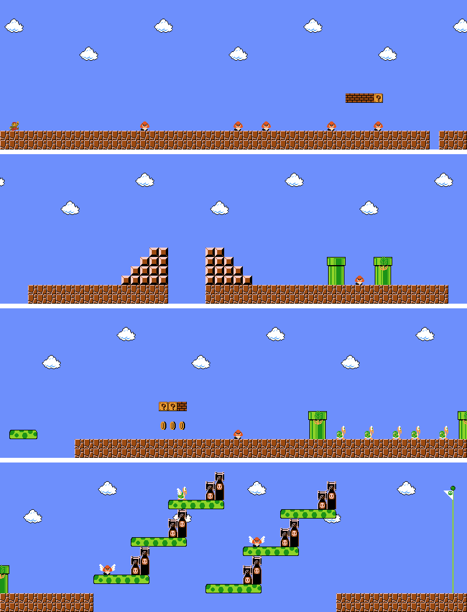

# Project Write-up

<!-- Keep the completed narrative to approximately 1–2 pages. -->

## Design Goal and Architecture

<!-- Caleb owns this subsection. -->

Our goal at the beginning was to create a level generator that used grammar
rules as the technique or one of the techniques for generating levels. When
brainstorming, we decided that using a tiling approach would best fit with
grammar rules and it would allow us to create levels that are both varied and
structured. It was also easier to implement and maintain than other approaches.
So with this in mind, we used tiling to create chunks of the map that could be
reused and combined according to the grammar rules. We also gave the chunks some
randomness controlled by the seed to ensure that the generated levels would have
even more variety.

We wanted levels to start with easier challenges, build up to harder sections,
give the player a short recovery, and finish with a final challenge. The generator
uses the grammar to choose the section order, then selects chunks and assigns
their widths to fit the level. It places the chunks from left to right with
matching ground heights, a start, and an exit. The same seed and width reproduce
the same level when using the same generator version. The grammar itself is
defined in the section below.

## Generation Technique

<!-- Nic owns this subsection, with Caleb contributing the grammar and assembler explanation. -->

| Symbol | Expands to |
| --- | --- |
| `LEVEL` | `START BUILDUP PEAK RECOVERY BUILDUP CLIMAX EXIT` |
| `START` | `start` |
| `EXIT` | `exit` or `staircase-exit` |
| `BUILDUP` | `D1` or `D1 BUILDUP` or `D1 D2` |
| `PEAK` | `D3` or `D2 PEAK` |
| `RECOVERY` | `D0` or `D0 RECOVERY` |
| `CLIMAX` | `D3` or `D3 CLIMAX` or `D4` |

`D` stands for difficulty. Difficulty of chunks ranges from `D0` (easiest) to
`D4` (hardest).

The assembler expands the grammar from left to right, randomly choosing one of
the available grammar rules that leave enough room for the remaining sections.
It selects matching chunks with the required difficulty and width, and assigns
widths within their limits to fill the requested level width. Extra flat chunks
can also be added to the recovery section if needed to fill the requested level
width. Chunks are then placed in order, passing the ground height to the next
chunk so the ground level of each chunk lines up and looks continuous.

**Chunk library.** The grammar's terminals are 15 hand-authored chunk types
modeled on `levels/original/`, pieces of content that are recombined
[PCG I slide 71]. `D0` has `flat` and `block-row`. `D1` has `single-gap`,
`single-pipe` and `single-goomba`. `D2` has `staircase-gap`, `gap-run`,
`pipe-run` and `enemy-group`. `D3` has `piranha-koopa` and
`floating-platforms`. `D4` has `bullet-bill-platform`. The start and exit
chunks are `start`, `exit` and `staircase-exit`. Every random choice comes from
the level's one seeded `java.util.Random`, so a seed and width reproduce the
file byte for byte [PCG II slide 58].

**Jump limits.** Jumping is hard, so we hardcode it [Movement II slide 47],
using limits measured in the engine. `JumpProbe` drives the engine headless
with a scripted player. Small Mario jumps 4 tiles high at any speed. From a
standstill holding run he clears a 5-tile gap, with a long running start he
clears 11. Low ceilings shorten jumps. `JumpLimits` keeps the standing-start
numbers minus a one-tile margin: a rise of at most 3 and a level gap of at
most 4. The chunks and the checker share these limits, so no section needs a
running start.

**Playability checker.** `PlayabilityChecker` runs a deterministic
breadth-first search over a navigation graph [Movement I slide 19]. The nodes
are the tiles Mario can stand on. The edges are walks, falls, and jumps within
the limits, including ceiling headroom. It models terrain only: enemies count
as avoidable, and pipes, cannons and bricks count as solid. It returns the
first column Mario cannot reach and a reason. Sixteen hand built and
hand-broken levels give the expected answers. With the raw measured limits, it
passes 7 of the 15 original levels and rejects all three that the A* agent
loses (lvl-3, lvl-6 and lvl-10).

**Generate & test.** If the finished level fails the check, the assembler
re-places the failing section with new choices from the same `Random`
[PCG II slide 47]. After three failed retries, that section becomes flat
ground, so the loop always ends and stays reproducible. With the starter
chunks, which had an 8-tile gap and 4-tile pipes, the loop repaired seeds
1–100 using 587 retries and 183 flat fallbacks. After we bounded every chunk by `JumpLimits`, seeds
1–100 pass on the first try (`Check --seeds 1 100`). Every chunk also passes
alone at every width it allows (`Check --chunks`).

## Evaluation and Results

<!-- Ryan owns this subsection. -->

- TODO summarize the experiment design and compare generated levels with the baselines.
- TODO include the measured results table and any plots that help explain it.
- TODO interpret playability, variety, retry counts, and other selected measurements against the design goals.

## Limitations and Lessons Learned

<!-- Each teammate contributes findings from their work. -->

- TODO discuss observed failure cases, repetition, checker limitations, and agent evaluation variability.
- TODO explain what worked, what changed during development, and what the team learned.

- There was limitation to how much variety we could achieve in the generated
  levels, even with all the randomization applied within each chunk. The
  downside of an easier approach and more playable levels was that the chunk
  library limited the variety of layouts we could generate.
- Combining grammar rules with tiling made the assembler more complex than we
  expected. A rule could fit the current section but use up the width needed by
  later sections. We had to reserve the minimum widths of the remaining sections
  before choosing an expansion, which also bounded recursion. The assembler then
  had to fit the selected chunks into the level and keep their boundaries like
  the ground level aligned.
- Measuring beat guessing. Two starter chunks needed a running start or a
  near-perfect jump, and only the engine probe showed it. The safety margin
  has a cost: under the design limits, the checker rejects most original levels.
- The checker ignores enemies, so it guarantees passable terrain, not an easy
  level. The agent playthroughs cover the enemies.
